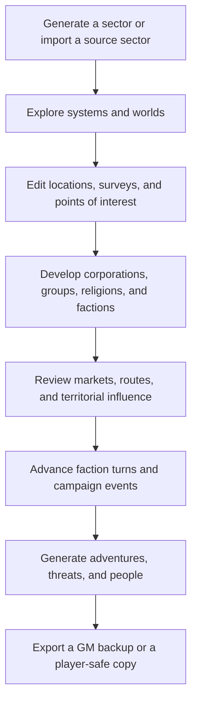

<div align="center">

# Sector Forge

### A sector generator and campaign workbench for *Stars Without Number: Revised Edition*

Build a region of space, populate its worlds, connect its markets and factions, and turn the resulting setting into a living campaign.

<p>
  <a href="https://satoru-suzukii.github.io/swn-sector-forge/">
    
  </a>
</p>

<p>
  
  
  
  
  
</p>

<p><i>A browser-based toolkit for building the places, powers, economies, and problems that make a science-fiction campaign.</i></p>

</div>

---

## At a glance

| | |
|:---|:---|
| **What it is** | A browser-based sector generator and campaign workbench. |
| **Game system** | *Stars Without Number: Revised Edition* — unofficial fan project. |
| **Map size** | 10 × 12 hexes (120 selectable hexes). |
| **Generation profiles** | Revised Edition core and Expanded World Generation. |
| **Technology** | HTML, CSS, and vanilla JavaScript. |
| **Setup** | No account, application server, framework, package installation, or build step required to use the app. |
| **Data handling** | Sector data stays in the browser unless you choose to export or share it. |

> **Unofficial fan project:** Sector Forge is not affiliated with, sponsored by, or endorsed by Sine Nomine Publishing. *Stars Without Number* and its related marks belong to their respective rights holder. See the [official product page](https://sine-nomine-publishing.myshopify.com/products/stars-without-number-revised).

## Contents

- [What Sector Forge does](#what-sector-forge-does)
- [Core features](#core-features)
- [Campaign workspaces](#campaign-workspaces)
- [A typical campaign workflow](#a-typical-campaign-workflow)
- [Getting started](#getting-started)
- [Importing Sectors Without Number data](#importing-sectors-without-number-data)
- [Saving, sharing, and export privacy](#saving-sharing-and-export-privacy)
- [Project structure](#project-structure)
- [Testing and validation](#testing-and-validation)
- [Scope and limitations](#scope-and-limitations)
- [Compatibility and acknowledgements](#compatibility-and-acknowledgements)
- [License](#license)
- [Feedback](#feedback)

---

## What Sector Forge does

Sector Forge is designed for referees who want more than a randomly generated star map. It creates a connected campaign region containing systems, worlds, surveys, markets, routes, corporations, political groups, and factions.

You can generate a new sector or import data from **Sectors Without Number**, inspect and edit its systems, build the groups competing for power, simulate faction activity, and generate adventure material from the setting you have created.

The different parts of the sector are connected through shared records. A world's market can reflect nearby routes and political influence; corporate contracts can refer to market records; factions can exert influence over systems; and world tags can feed into adventure generation.

## Core features

<table>
  <tr>
    <td width="50%" valign="top">
      <h3>Sector generation</h3>
      Generate a 10 × 12 sector using either the Revised Edition core profile or Expanded World Generation. Choose how populated the sector should be and independently control the amount of world and orbital content.
    </td>
    <td width="50%" valign="top">
      <h3>Interactive hex map</h3>
      Explore 120 selectable hexes, inspect systems, create systems in empty hexes, and move or edit existing systems through deliberate map controls.
    </td>
  </tr>
  <tr>
    <td width="50%" valign="top">
      <h3>Worlds and surveys</h3>
      Generate and manage worlds, stellar survey objects, planets, orbital installations, and points of interest. Related world and system records stay linked.
    </td>
    <td width="50%" valign="top">
      <h3>Campaign simulation</h3>
      Develop corporations, political groups, religions, and custom Forge factions. Track markets, routes, influence, diplomacy, assets, upkeep, and faction activity.
    </td>
  </tr>
  <tr>
    <td width="50%" valign="top">
      <h3>Adventure generation</h3>
      Turn world tags and campaign context into adventure seeds, patrons, opposition, complications, stakes, and rewards. Generate additional frontier prompts and NPC concepts.
    </td>
    <td width="50%" valign="top">
      <h3>Import and export</h3>
      Import native JSON or entity CSV exports from Sectors Without Number. Export a full GM backup or create a filtered player-facing copy and compressed share link.
    </td>
  </tr>
</table>

### Generation controls

The default generation flow is intentionally straightforward. Advanced options remain collapsed until you choose to adjust them.

**System density** controls how many of the 120 hexes contain systems:

| Preset | Approximate occupied systems |
|:--|--:|
| Empty | 0 |
| Scarce | 8–14 |
| Default | 21–30 |
| Normal | 31–40 |
| Crowded | 45–65 |

**World & orbital content** is a separate setting. Its presets are **Empty**, **Scarce**, **Default**, **Normal**, and **Crowded**. This changes the overall amount of planetary, surface, and orbital content; exact counts vary from generation to generation.

### Map editing

- **Edit mode starts OFF.** Editing controls stay out of the way until you enable them.
- Create a system in an empty hex, or select a system and use **Move selected system** before choosing an empty destination.
- Edit system names, planets, orbital survey objects, and points of interest.
- Unrecognized imported dropdown values are retained when supported records are edited, rather than being silently cleared.
- Black-hole systems retain a distinct primary type and corresponding map marker, inspector label, and accessible name.
- An independent **Faction domination** toggle displays faction-coloured systems, control rings, and contested-system highlighting.

The map uses a fixed viewport rather than drag-to-pan or wheel zoom. Select-and-act movement controls help prevent accidental map movement and keep page scrolling predictable on touch devices.

---

## Campaign workspaces

| Workspace | Purpose |
|:--|:--|
| **Sector Map** | Browse, select, inspect, and edit star systems. |
| **Worlds** | Review the generated world directory and individual world records. |
| **Corporations** | Create corporate actors and manage their campaign relationships and market contracts. |
| **Political Groups** | Develop movements, coalitions, and other political organizations. |
| **Religions** | Generate faiths and ideological forces that shape worlds. |
| **Aliens** | Create non-human life, societies, and first-contact complications. |
| **Factions** | Manage custom Forge factions, goals, assets, upkeep, readiness, diplomacy, and turn-by-turn activity. |
| **Trade & Routes** | Explore trade and scout links, political blocs, territorial influence, and local commodity markets. |
| **Adventure Lab** | Generate adventure seeds with patrons, opposition, complications, stakes, and rewards. |
| **Frontier Lab** | Create prompts for espionage, trade, military operations, navies, cyberpunk, weird phenomena, outposts, ruins, and relics. |
| **Threats & People** | Generate threat scaffolds, NPC concepts, and patron ideas. |
| **Export & Share** | Download sector JSON or create a compressed share URL. |

### Markets, routes, and factions

Markets are linked to worlds and systems; corporate contracts refer to the relevant market records. Route access, corporate presence, territorial control, conflict pressure, and campaign state contribute to the local market picture.

Faction turns use a **streamlined, original simulation model**. A turn can resolve income and upkeep, asset operations and repairs, purchases, attacks, influence expansion, and campaign events. It is designed to give referees evolving pressures and story opportunities—not to reproduce every official faction rule, asset, or special ability in full.

---

## A typical campaign workflow

The tools are independent enough to use selectively, but they can also support a connected preparation loop:



This is a suggested workflow, not a required sequence. You can return to the map, change the sector, or use individual workspaces whenever your campaign needs them.

---

## Getting started

### Run locally

1. Download or clone the repository.
2. Open a terminal in the folder containing `index.html`.
3. Start a local web server:

   ```bash
   python -m http.server 8000
   ```

   On systems where Python is installed as `python3`, use:

   ```bash
   python3 -m http.server 8000
   ```

4. Open [http://localhost:8000](http://localhost:8000) in your browser.

> **Why use a local server?** Sector Forge loads local text-data files. Browsers may block those requests when the app is opened directly through a `file://` URL, so serve the project over HTTP instead.

### Publish with GitHub Pages

Sector Forge is a static web app and can be hosted through GitHub Pages without an application backend.

1. Keep `index.html`, `planet.css`, the JavaScript files, the `generators/` directory, and their supporting files in the repository with their relative paths intact.
2. Push the project to GitHub.
3. Open **Settings → Pages** in the repository.
4. Under the build and deployment settings, choose **Deploy from a branch**.
5. Select the branch you publish from (commonly `main`) and the repository root (`/`) as the folder, then save.
6. Open the Pages URL provided by GitHub.

The app references scripts, stylesheets, icons, and generator data through relative paths, so preserve the directory structure when publishing under a repository subpath.

---

## Importing Sectors Without Number data

From the launch screen, select an import mode and choose either a native JSON export or an entity CSV export from **Sectors Without Number**. **Native JSON is preferred** because it carries more stable IDs and relationship data.

<details>
<summary><strong>Import modes and what they change</strong></summary>

| Mode | Behavior |
|:--|:--|
| **Import as-is · leave missing details blank** | Default mode. Does not generate missing facility occupations, situations, or imported-world gravity. Original source records remain available in the Source Data workspace and GM JSON archive. |
| **Import and generate missing details** | Explicitly fills supported blank facility occupation/situation fields and generates gravity for imported worlds that lack it. Existing imported values are not overwritten. Forge-filled details are marked as such, and the raw source JSON remains unchanged. |

The enrichment mode supports facility types including research bases, moon bases, stations, mines, asteroid bases/belts, and orbital ruins. Some entities, such as moons, intentionally have no occupation/situation table and remain without invented details.

</details>

<details>
<summary><strong>Coordinate handling, source records, and CSV limitations</strong></summary>

- Native JSON system/entity `x/y` coordinates are normalized from SWN's one-based coordinates to Forge's zero-based grid. Route and layer hex keys are already zero-based and are handled separately.
- Supported physical entities—including moons, bases, stations, and ruins—are included in the system survey.
- Supported navigation route paths are drawn over the map, and supported layer regions are converted into Forge's region model.
- Source factions are available as reference records. They are not silently converted into Forge's separate faction-turn model.
- The complete source JSON payload is retained in the GM archive.
- CSV is a best-effort fallback. It lacks the same stable ID and relationship data as JSON, so parent links may need to be inferred from names and locations. Records whose parent cannot be resolved confidently are preserved in Source Data rather than discarded.

See [FEATURE_PARITY.md](FEATURE_PARITY.md) for detailed importer coverage and known gaps. The native JSON importer is regression-tested against the supplied Acheron Rho export dated **October 30, 2026**, along with synthetic edge cases.

</details>

---

## Saving, sharing, and export privacy

Sector Forge does not send your sector to a Sector Forge server. The active sector is held by the browser application. A share URL compresses sector data into the URL; heavily developed sectors can produce long links, so JSON export is the more reliable backup and transfer format.

The **Export & Share** workspace provides two types of export:

| Export | Intended use | Contents |
|:--|:--|:--|
| **GM JSON / GM link** | Complete backup and continued editing | Referee-facing information, hidden details, campaign factions, GM notes, custom points of interest, custom orbital survey objects, and attached original SWN source data. |
| **Player JSON / player link** | Filtered copy for sharing with players | Removes selected secret fields, rebuilds some descriptions to hide tag names, retains visible imported SWN survey entities, and excludes hidden entities and their descendants. It also omits GM-only source data and notes, points of interest, custom non-imported orbital survey objects, and campaign faction data. |

> [!IMPORTANT]
> **Review player-safe exports before sharing them.** Imported SWN `isHidden` flags are applied to systems, planets, facilities, and nested descendants, but player export is a practical filtering tool—not a formal security boundary. Keep the GM export private and share only a player version you have checked.

**Use GM JSON as your real backup.** Player JSON is a censored sharing copy, not a full-fidelity save. Do not use it when you need to preserve every editable campaign detail.

---

## Project structure

<details>
<summary><strong>View the repository layout</strong></summary>

```text
.
├── index.html                         # App entry point and workspace markup
├── planet.css                         # Application styling and responsive layout
├── app.js                             # Sector state, UI logic, and campaign integration
├── hexmap.js                          # SVG hex map and map editing behavior
├── sector-grid.js                     # Grid dimensions, coordinate checks, and viewport sizing
├── swn-import.js                      # Sectors Without Number JSON/CSV import adapter
├── url-param.js                       # URL parameter support
├── lzstring.min.js                    # URL-safe compression for sector links
├── dynmodal.js                        # Modal dialog behavior
├── dynedit.js                         # Editing helpers
├── dyntable.js                        # Table helpers
├── dyntab.js                          # Tab navigation helpers
├── dynspoiler.js                      # Spoiler/collapse helpers
├── textload.js                        # Local text-data loading
├── favicon.svg                        # Scalable Sector Forge icon
├── favicon-16x16.png                  # Small browser-tab icon
├── favicon-32x32.png                  # Standard PNG favicon
├── favicon.ico                        # Legacy browser favicon fallback
├── favicon-192x192.png                # High-resolution icon
├── favicon-512x512.png                # High-resolution icon master
├── apple-touch-icon.png               # iOS home-screen icon
├── generators/
│   ├── world-generator.js             # World generation
│   ├── star-system-generator.js       # Star system generation
│   ├── world-terrain-generator.js     # Terrain generation
│   ├── campaign-tools.js              # Campaign toolkits and prompts
│   └── data/                          # Text tables and naming data
├── FEATURE_PARITY.md                  # SWN importer coverage and known gaps
├── export-worker.js                   # Off-thread export, redaction, and link compression
├── tests/
│   ├── run-audit.cjs                  # Generator and data-integrity audit
│   ├── e2e.cjs                        # Chromium browser end-to-end suite
│   ├── export-worker.cjs              # Worker-thread export/privacy regression
│   ├── import-validation.cjs          # CSV/native JSON import checks
│   ├── fixtures/                      # Supplied SWN CSV regression exports
│   ├── *-validation-report.json       # Recorded validation reports
│   └── release-validation-report.json # Packaged 1.0 release check
├── CHANGELOG.md                       # Development history
└── README.md                          # This file
```

The favicon files sit beside `index.html` and use relative paths (for example, `./favicon.svg`). The SVG is the primary icon; PNG, ICO, and Apple touch icon files provide compatibility fallbacks. Relative paths allow the icons to resolve when GitHub Pages serves the repository beneath a project path such as `/repository-name/`.

</details>

---

## Testing and validation

Using the app does not require installing packages. The automated checks use **Node.js**; the browser end-to-end suite additionally requires **Node.js 22 or newer** and a Chrome/Chromium executable.

<details>
<summary><strong>Generator and campaign audit</strong></summary>

Run from the repository root:

```bash
node tests/run-audit.cjs
```

The audit exercises core and expanded generation, black-hole primary consistency, data relationships, routes, markets, faction turns, and campaign-tool output.

Additional validation commands:

```bash
node tests/import-validation.cjs
node tests/export-worker.cjs
```

These validate the supplied CSV exports and native JSON fixture, then execute the export worker on a separate Node worker thread and check that player-safe JSON matches the app's privacy filter.

To increase the workload, use environment variables such as:

```bash
SWN_CORE_RUNS=10000 SWN_EXPANDED_RUNS=3000 SWN_FACTION_SECTORS=60 node tests/run-audit.cjs
```

</details>

<details>
<summary><strong>Chromium browser end-to-end tests</strong></summary>

Run:

```bash
node tests/e2e.cjs
```

The suite uses Chrome DevTools Protocol and Node's built-in `WebSocket`. If Chrome/Chromium is not on your `PATH`, set `CHROME_BIN` to its executable path:

```bash
CHROME_BIN=/path/to/chromium node tests/e2e.cjs
```

An offline-inline mode is available for environments where the test browser cannot navigate to a localhost server:

```bash
E2E_INLINE=1 node tests/e2e.cjs
```

The export worker is loaded dynamically from `export-worker.js` when served from a same-origin HTTP(S) site. Browsers that disallow workers, including some `file://` previews, use the synchronous compatibility fallback.

</details>

### Validation reports

The repository includes recorded JSON reports for validation runs performed during development. [`tests/release-validation-report.json`](tests/release-validation-report.json) documents the checks recorded for this packaged 1.0 snapshot, including grid and import coverage, generator/faction audit, JavaScript syntax checks, local-reference checks, and the Chromium end-to-end suite.

Run the commands above against the exact commit you intend to publish when refreshing validation for a later revision. Supporting reports:

- [`FIXES_2026-11-07_TEST_REPORT.md`](FIXES_2026-11-07_TEST_REPORT.md) — earlier import, faction, and black-hole fixes.
- [`EDITOR_PERFORMANCE_FIX_REPORT_2026-11-07.md`](EDITOR_PERFORMANCE_FIX_REPORT_2026-11-07.md) — follow-up editor-control and export-performance work.

---

## Scope and limitations

Sector Forge is a **campaign-generation and referee-support tool**, not an official rules engine or a complete digital edition of *Stars Without Number*.

- The **Revised Edition core** profile implements the core generation concepts used by the app. It does not claim exhaustive, line-by-line parity with the entire core book or every supplement.
- **Expanded World Generation** adds optional population estimates and related behavior. It is a campaign-generation profile, not a guarantee of exact outcomes for every table or edge case in the rules.
- Market prices and trade behavior are original campaign estimates, not a direct transcription of *Suns of Gold* procedures.
- Faction simulation uses a streamlined generic asset catalog. It does not implement every official asset, ability, or edge case.
- Frontier toolkits generate original prompts inspired by common campaign themes. Character outputs are concept dossiers, not complete rules-legal character sheets.
- Generated results are prompts for play. Referees should review, adjust, and adjudicate them for their campaigns.

## Compatibility and acknowledgements

### Sectors Without Number import status

The importer is still a work in progress and does **not** provide complete feature parity with Sectors Without Number. Current support includes:

- Native JSON and entity CSV import.
- Normalized coordinate mapping and supported system/world conversion.
- Preservation of original source records, with explicit preserve and enrich modes.
- Drawing supported native navigation routes and converting supported layer regions.
- A Source Data view for exported faction records.
- Preservation of black-hole primary types and unrecognized imported planet values during supported edits.
- Separate handling for imported SWN faction reference data and editable Forge campaign factions.

Some upstream entity types remain source records rather than fully editable Forge objects. Imported navigation routes remain separate from Forge trade routes, and imported SWN factions are not silently run through Forge's different faction simulator. See [FEATURE_PARITY.md](FEATURE_PARITY.md) for the detailed status and known gaps.

### Third-party data and inspiration

The optional import-enrichment feature adapts English facility occupation/situation entries from [Sectors Without Number](https://github.com/mpigsley/sectors-without-number) by Mitchel Pigsley, used under its MIT License. This source data is used only to fill blank values when the explicit enrichment mode is selected; imported values are preserved. See [`THIRD_PARTY_NOTICES.md`](THIRD_PARTY_NOTICES.md).

Thanks to [Hamhambone's SWN Sector Generator](https://hamhambone.github.io/swn/) for inspiration and reference during development. Sector Forge is a separate implementation and is not affiliated with or endorsed by Hamhambone.

*Stars Without Number* is a role-playing game published by Sine Nomine Publishing. Sector Forge is an unofficial fan-made project and does not claim ownership of the game, its setting, or any third-party material. See the [official product page](https://sine-nomine-publishing.myshopify.com/products/stars-without-number-revised).

## License

Sector Forge is distributed under the [MIT License](LICENSE).

## Feedback

Found a bug, broken link, or generation result that looks wrong? Open an issue in the repository and include steps to reproduce the problem. For data-related issues, attach a small example sector JSON after removing private campaign notes and other sensitive information.

---

<div align="center">

**Build a sector. Shape its powers. Give your campaign somewhere to go.**

<sub>Sector Forge 1.0 · Unofficial Stars Without Number campaign tool</sub>

</div>
