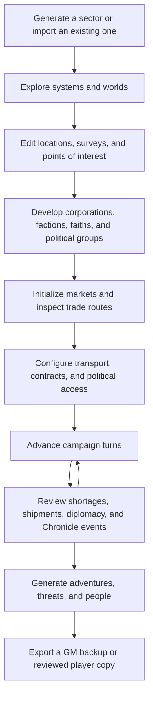

<div align="center">

# Sector Forge

### A sector generator and living campaign workbench for *Stars Without Number: Revised Edition*

Generate a region of space, populate its worlds, connect its markets and trade routes, develop the powers competing across it, and let the sector change as the campaign advances.

<p>
  <a href="https://satoru-suzukii.github.io/swn-sector-forge/">
    
  </a>
</p>

<p>
  
  
  
  
  
</p>

<p><i>A browser-based toolkit for building the places, economies, organizations, conflicts, and problems that make a science-fiction campaign feel alive.</i></p>

</div>

---

## At a glance

| | |
|:---|:---|
| **What it is** | A browser-based sector generator, campaign workbench, and referee-facing living-sector simulation. |
| **Game system** | *Stars Without Number: Revised Edition* — unofficial fan project. |
| **Map** | A 10 × 12 hex sector with 120 selectable locations. |
| **World generation** | Revised Edition Core profile and an optional Expanded World Generation profile. |
| **Campaign systems** | Worlds, markets, corporations, factions, politics, diplomacy, logistics, transport, contracts, and campaign history. |
| **Technology** | HTML, CSS, and vanilla JavaScript. No framework or application build pipeline. |
| **Setup** | No account, backend, package installation, or build step required. A local HTTP server is recommended for local use. |
| **Data handling** | The sector is managed in the browser. Nothing is uploaded to a Sector Forge server. You choose when to export or share it. |
| **Release** | **1.4.1** — maintenance release; no saved-sector schema migration. |

> **Unofficial fan project:** Sector Forge is not affiliated with, sponsored by, or endorsed by Sine Nomine Publishing. *Stars Without Number* and its related marks belong to their respective rights holder. Sector Forge is a separate fan-made implementation, not an official rules engine or digital edition. See the [official publisher website](https://www.sinenomine-pub.com/?page_id=395).

## Contents

- [What Sector Forge does](#what-sector-forge-does)
- [Core features](#core-features)
- [Generation and map editing](#generation-and-map-editing)
- [Campaign workspaces](#campaign-workspaces)
- [The Living Sector simulation](#the-living-sector-simulation)
- [A typical campaign workflow](#a-typical-campaign-workflow)
- [Getting started](#getting-started)
- [Importing Sectors Without Number data](#importing-sectors-without-number-data)
- [Saving, sharing, and export privacy](#saving-sharing-and-export-privacy)
- [Data compatibility and versioning](#data-compatibility-and-versioning)
- [Project structure](#project-structure)
- [Testing and validation](#testing-and-validation)
- [Scope and limitations](#scope-and-limitations)
- [Compatibility and acknowledgements](#compatibility-and-acknowledgements)
- [License](#license)
- [Feedback](#feedback)

---

## What Sector Forge does

Sector Forge is designed for referees who want more than a randomly generated star map. It creates a connected campaign region containing systems, worlds, orbital survey objects, markets, trade routes, corporations, political groups, religions, alien life, factions, and adventure material.

The generator provides the starting material. The campaign workspaces let you inspect and change that material. The Living Sector simulation then uses the resulting locations, organizations, markets, routes, and political conditions to create evolving pressures: shortages, shipments, commercial agreements, disputes, changing access, faction decisions, and events worth bringing to the table.

You can start with a newly generated sector or import a supported export from **Sectors Without Number**. You can use the workspaces independently, or connect them into a campaign that develops over many turns.

## Core features

<table>
  <tr>
    <td width="50%" valign="top">
      <h3>Sector generation</h3>
      Generate a 10 × 12 region with adjustable system density and separate controls for planetary and orbital content. Choose the Revised Edition Core profile or Expanded World Generation.
    </td>
    <td width="50%" valign="top">
      <h3>Interactive hex map</h3>
      Explore 120 selectable hexes, inspect systems, create systems in empty locations, move selected systems, and edit their world and survey records.
    </td>
  </tr>
  <tr>
    <td width="50%" valign="top">
      <h3>Worlds and surveys</h3>
      Generate and manage planets, world tags, terrain, orbital bodies, installations, stations, ruins, and points of interest. Related system and world records remain connected.
    </td>
    <td width="50%" valign="top">
      <h3>Living economies</h3>
      Track local commodity stock, production, consumption, shortages, prices, multi-hop shipments, route capacity, and delivered supply.
    </td>
  </tr>
  <tr>
    <td width="50%" valign="top">
      <h3>Campaign powers</h3>
      Develop corporations, factions, political groups, religions, and alien societies. Track influence, diplomacy, treaties, sanctions, war, ceasefires, and peace.
    </td>
    <td width="50%" valign="top">
      <h3>Transport and commerce</h3>
      Manage spaceports, fleets, freight profiles, recurring supply contracts, commercial accounts, route costs, tariffs, and cargo incidents.
    </td>
  </tr>
  <tr>
    <td width="50%" valign="top">
      <h3>Adventure generation</h3>
      Generate adventure seeds, patrons, opposition, complications, stakes, rewards, frontier prompts, threats, and people of interest.
    </td>
    <td width="50%" valign="top">
      <h3>Import, export, and recovery</h3>
      Import native JSON or entity CSV from Sectors Without Number. Create GM backups, filtered player copies, compressed share links, and optional local recovery snapshots.
    </td>
  </tr>
</table>

---

## Generation and map editing

### Sector generation

The standard map contains **10 columns × 12 rows**, giving 120 selectable hexes. The advanced generation options are collapsed by default so a new sector can be created without having to configure every detail.

**World generation profile** selects the rules profile used to create worlds:

| Profile | Description |
|:--|:--|
| **Revised Edition Core** | The default world-generation profile, using the core generation approach implemented by Sector Forge. |
| **Expanded World Generation** | An optional extended profile that adds population estimates, population-linked Tech Level outcomes, and a third tag candidate. Fields exclusive to Expanded are identified when they do not apply to Core-generated worlds. |

**System density** controls the approximate number of occupied hexes:

| Preset | Approximate occupied systems |
|:--|--:|
| Empty | 0 |
| Scarce | 8–14 |
| Default | 21–30 |
| Normal | 31–40 |
| Crowded | 45–65 |

**World & orbital content** is configured separately from system density. Its presets are **Empty**, **Scarce**, **Default**, **Normal**, and **Crowded**. This controls the amount of planetary, surface, and non-planet survey content generated within systems. Exact results vary between generations.

### Map editing

- Select systems to inspect their location and related world records.
- Create a system in an empty hex and move an existing system to another empty destination.
- Edit system details, planets, orbital survey objects, and points of interest.
- Generate and display black-hole systems with their own primary-body representation and map marker.
- Preserve supported imported dropdown values that are not part of Sector Forge's own standard option lists when editing an imported record.
- Enable faction-domination overlays to display faction-coloured systems, control rings, and contested locations.

The map is designed around deliberate select-and-act editing rather than drag-to-pan or wheel zoom. This keeps map editing predictable on touch devices and reduces accidental map movement.

---

## Campaign workspaces

| Workspace | Purpose |
|:--|:--|
| **Sector Map** | Browse, select, inspect, create, move, and edit star systems. View faction domination and sector geography. |
| **Worlds** | Browse and edit planetary records, world-generation details, tags, terrain, population, and Tech Level. |
| **Source Data** | Review source entities preserved from an imported Sectors Without Number export. |
| **Corporations** | Create and manage corporate actors, ownership, sector interests, market links, strategies, and supply relationships. |
| **Political Groups** | Develop movements, coalitions, and organizations with influence across the sector. |
| **Religions** | Create faiths, sects, cults, and ideological forces that shape worlds and societies. |
| **Aliens** | Generate and edit a sector alien catalog. New sectors generate 3–8 entries; imported or saved catalogs are preserved. |
| **Factions** | Manage custom Forge factions, goals, assets, resources, upkeep, influence, diplomacy, autonomy, and turn-by-turn activity. |
| **Trade & Routes** | Inspect trade and scout routes, local markets, interstellar logistics, transport infrastructure, contracts, formal political agreements, and commercial finances. |
| **Adventure Lab** | Generate adventure seeds using the sector's locations, tags, patrons, opposition, complications, stakes, and rewards. |
| **Frontier Lab** | Create prompts for espionage, commerce, military operations, naval activity, vehicles, cyberpunk, weird phenomena, outposts, ruins, relics, and adventure sites. |
| **Threats & People** | Generate threat stat scaffolds, NPC concepts, patrons, and people of interest. |
| **Export & Share** | Download GM or player-facing JSON, create compressed share links, and manage local recovery snapshots. |

The directories and workspaces are intended to work together, but none of them requires a fixed preparation order. You can generate a sector and use only the map, build a setting around an imported sector, or run the full economy and faction campaign model.

---

## The Living Sector simulation

The Living Sector is the main step beyond a conventional sector generator. It is a **referee-facing campaign simulation**, not a complete economic simulator or an attempt to reproduce every official faction rule. Its purpose is to make the sector's organizations and locations respond to one another in ways that produce useful campaign developments.

### Local markets and commodity economy

When initialized, each market receives commodity accounts with local stock, target stock, production, consumption, demand, and storage limits. Economic turns update inventories and record market ledgers. Prices respond to local stock conditions and broader reachable-market competition, subject to GM-authored field overrides.

Newly generated sectors initialize their local economy. Older native Forge saves and imported Sectors Without Number sectors remain uninitialized until the referee selects **Initialize local economy** in Trade & Routes. This creates a new stock baseline; it does not reconstruct historical inventories that were never recorded.

### Interstellar logistics

Surplus goods can be moved to shortages through eligible trade routes. Shipments use weighted multi-hop paths and persistent leg-by-leg progress rather than teleporting directly to their destination.

- Routes can define directional access, per-turn capacity, travel time, freight, tolls, risk, and operating costs.
- Shipments wait when a route is at capacity and progress over later campaign turns.
- Transit incidents can delay a shipment or cause recorded cargo loss.
- Destination storage and market demand constrain final delivery.
- Diplomatic access, transit rights, tariffs, and commodity embargoes apply to controlled borders.
- Delivered cargo updates destination inventory, campaign accounts, logistics ledgers, and Chronicle events.

The route graph is shared with the sector's trade-route rules so that route availability is not independently interpreted by every campaign feature.

### Contracts, finance, and transport

The Trade & Routes workspace includes referee-authored recurring supply contracts between markets. A contract can specify a commodity, delivery volume, priority, date range, and optional fixed price. Contracts prioritize qualifying shipments but do **not** guarantee delivery or bypass available stock, route capacity, cargo losses, destination storage, or diplomatic restrictions.

Commercial settlement uses **Cr** as a campaign accounting unit. It is separate from the legacy SWN faction **FacCreds** field. The settlement layer records transfers for freight, tolls, tariffs, route operating expenses, and delivered commodity purchases between market, faction, corporate, customs, and service accounts.

Spaceports and fleets represent abstract transport infrastructure. Spaceports constrain cargo handling; commissioned fleets can add route capacity and affect transit speed, reliability, and recurring costs. They are not a tactical ship movement, crew, fuel, hull combat, or convoy-management simulator.

### Factions, corporations, and politics

Faction and corporate actors can assess their goals, assets, resources, market dependencies, threats, and diplomacy. Their decisions are bounded campaign actions rather than unrestricted autonomous play. Strategic reports explain relevant conditions and uncertainty; GM controls and field-level manual overrides remain authoritative.

The political layer supports referee-authored treaties, sanctions, wars, ceasefires, and peace transitions. Faction diplomacy tracks bilateral relationships; formal polity relations use a separate political model. With political autonomy enabled, faction actors can propose limited trade, transit, and non-aggression agreements, respond to older offers, and seek ceasefire or peace under pressure. Polity-to-polity diplomacy remains referee-directed.

Corporate actors can compare supplier offers using expected delivered cost and observed delivery reliability before committing to a supply contract. This creates a link between corporate decisions and actual route/logistics conditions without claiming to model every corporate decision or the full interstellar economy.

### Campaign history and turn resolution

Advancing a campaign turn processes the simulation phases in a defined order. The campaign history and Chronicle record faction, economic, commercial, logistical, political, and strategic developments. Chronicle entries can include actors, affected records, locations, causes, effects, and private referee notes.

Large histories are kept manageable through configurable retention limits and a campaign-wide detail budget. Older detail can be compacted or archived while selected counters and settlement idempotency information are retained. This is not an unlimited event archive: download periodic GM JSON backups for long-running campaigns.

For a deeper implementation description, see:

- [SIMULATION_ARCHITECTURE.md](SIMULATION_ARCHITECTURE.md) — engine responsibilities, turn coordination, invariants, and architecture.
- [SIMULATION_DATA_MODEL.md](SIMULATION_DATA_MODEL.md) — persisted records, ownership, inventories, logistics, accounts, politics, contracts, and history.

---

## A typical campaign workflow

The following is one possible way to use the connected tools. It is not a required sequence.



You can return to the map, edit a world, change a route, adjust a faction, or use an individual generator whenever the campaign needs it. Manual changes remain the referee's authority; automatic processes respect supported field-level overrides.

---

## Getting started

### Run locally

1. Download or clone the repository.
2. Open a terminal in the project folder containing `index.html`.
3. Start a local HTTP server:

   ```bash
   python -m http.server 8000
   ```

   On systems where Python is installed as `python3`, use:

   ```bash
   python3 -m http.server 8000
   ```

4. Open [http://localhost:8000](http://localhost:8000) in your browser.

Sector Forge is a static web application and has no build step. A local HTTP server is recommended because the app loads text tables from `generators/data/`. Browsers may block local data requests when the page is opened directly through a `file://` URL. Serving the app over HTTP(S) also provides the normal same-origin context used by browser features such as IndexedDB and native Web Workers.

### Publish with GitHub Pages

Sector Forge can be hosted as a static GitHub Pages site. No application backend is required.

1. Keep `index.html`, `planet.css`, the JavaScript files, and every supporting directory in the repository with their relative paths intact.
2. Push the project to GitHub.
3. Open **Settings → Pages** in the repository.
4. Under **Build and deployment**, choose **Deploy from a branch**.
5. Select the branch to publish (commonly `main`) and the repository root (`/`) as the folder, then save.
6. Open the Pages URL provided by GitHub after deployment.

Do not flatten the project or upload only `index.html`. The application loads scripts, stylesheets, generator data, simulation engines, icons, and worker code through relative paths. Preserve the supplied directory structure, especially when GitHub Pages serves the site under a repository subpath.

---

## Importing Sectors Without Number data

From the launch screen, choose an import mode and load either a native JSON export or an entity CSV export from **Sectors Without Number**. **Native JSON is preferred** because it carries more stable identifiers and relationship information.

### Import modes

| Mode | Behavior |
|:--|:--|
| **Import as-is · leave missing details blank** | Default mode. Preserves imported details and does not invent missing facility occupations, situations, or world gravity. Original source records remain available in Source Data and the GM JSON archive. |
| **Import and generate missing details** | Explicitly fills supported blank facility occupation/situation fields and generates gravity for imported worlds that lack it. Existing imported values are not overwritten. Forge-filled values are marked as generated, and the original source JSON remains unchanged. |

The optional enrichment mode supports facility types including research bases, moon bases, stations, mines, asteroid bases/belts, and orbital ruins. Some entity types, such as moons, intentionally have no occupation/situation table and remain without invented details.

### Coordinates, source records, and CSV limitations

- Native JSON system/entity `x/y` coordinates are normalized from Sectors Without Number's one-based coordinates to Forge's zero-based grid. Route and layer hex keys are already zero-based and are handled separately.
- Supported physical entities—including moons, bases, stations, belts, mines, and ruins—are included in the system survey.
- Supported native navigation route paths are drawn over the map, and supported layer regions are converted into Forge's region model.
- Imported source factions are preserved as reference records. They are not silently converted into Forge's separate faction-turn model.
- The original source JSON payload and normalized source records are retained in the GM archive and can be inspected through Source Data.
- CSV is a best-effort fallback. It does not carry the same stable IDs and relationship data as native JSON, so parent links may need to be inferred from names and locations. Ambiguous or unsupported records remain in Source Data rather than being discarded.
- Imported SWN navigation routes remain distinct from Forge's campaign trade/scout routes.

The importer does **not** claim complete feature parity with Sectors Without Number. Some upstream entity types remain source records rather than fully integrated Forge-native objects; navigation editing and the complete upstream layer editor are not implemented; and Forge does not currently export a sector back into Sectors Without Number's native JSON format.

See [FEATURE_PARITY.md](FEATURE_PARITY.md) for the supported-field matrix and known gaps, and [SOURCE_AUDIT.md](SOURCE_AUDIT.md) for the source/export contract and audit findings. Import behavior is regression-tested against the included Acheron Rho native JSON fixture and supplied CSV fixtures.

---

## Saving, sharing, and export privacy

Sector Forge does not send your sector to a Sector Forge server. The active sector is managed by the browser application. A compressed share URL contains the sector data in the URL itself; large or heavily developed campaigns can create long links, so JSON export is the more reliable backup and transfer format.

### GM and player exports

| Export | Intended use | Contents |
|:--|:--|:--|
| **GM JSON / GM link** | Complete referee backup and continued editing | Full referee-facing sector data, hidden details, GM notes, custom points of interest, custom orbital survey objects, campaign factions, simulation state, and attached original SWN source data. |
| **Player JSON / player link** | Filtered copy to review and share with players | Removes selected secret fields, rebuilds some descriptions to hide tag names, retains visible imported survey entities, and excludes hidden source entities and their descendants. It also omits GM-only source data and notes, points of interest, custom non-imported orbital survey objects, and campaign simulation/faction data. |

> **Review player-safe exports before sharing them.** Imported SWN `isHidden` flags are applied to systems, planets, facilities, and nested descendants, but player export is a practical filtering tool—not a formal security boundary. Do not assume that every secret written into custom prose or unusual source data will always be removed. Keep the GM export private and inspect the player copy before distributing it.

**Use GM JSON as your real backup.** Player JSON is a censored sharing copy, not a full-fidelity save. Do not use it when you need to preserve every editable campaign detail. Keep a separate GM backup before importing, editing, or sharing a developed campaign.

### Local recovery snapshots

The Export workspace offers optional manual and automatic local recovery snapshots. They use IndexedDB in the current browser profile and store a full GM sector for the current campaign. Snapshots are not uploaded, synchronized, or encrypted by Sector Forge. Anyone with access to the same browser profile may be able to access them, so avoid enabling recovery on shared devices.

A recovery checksum detects accidental corruption; it is not a security or authenticity mechanism. Browser storage can be cleared, blocked, or unavailable, and data may not be available after changing browser profiles or origins. Local recovery is a convenience feature, **not a substitute for downloading a GM JSON backup**.

---

## Data compatibility and versioning

The application release, root saved-sector schema, simulation envelope, and individual engine versions are separate identifiers.

- The application reports **1.4.1** and stamps newly generated sectors with that source application version.
- The root saved-sector `schemaVersion` remains **3**.
- The simulation envelope has its own schema and migration metadata under `sector.simulation`.
- Individual simulation engines retain their own implementation versions; they do not have to match the application release number.
- Version 1.4.1 does not introduce a saved-sector schema migration or change generator distributions, simulation rules, or campaign data contracts.
- Existing native Forge sectors continue through the established migration path. Imported SWN provenance remains distinct from Forge-generated source metadata.

Version 1.4.1 is a maintenance release. It fixes JavaScript runtime-scope leakage and asynchronous text-loading bookkeeping, adds regression tests for those defects, updates release identity, and improves documentation. It does **not** change the world-generation tables or distributions, simulation rules, root save schema, or persisted campaign data contracts. See [CHANGELOG.md](CHANGELOG.md) and [RELEASE_VERIFICATION_1.4.1.md](RELEASE_VERIFICATION_1.4.1.md) for the release record.

---

## Project structure

<details>
<summary><strong>View the repository layout</strong></summary>

```text
.
├── index.html                         # Application shell, launch screen, and workspaces
├── app.js                             # Application state, campaign UI, persistence, and orchestration
├── planet.css                         # Application styling and responsive layouts
├── hexmap.js                          # SVG sector map and map-editing behavior
├── sector-grid.js                     # Grid dimensions and coordinate helpers
├── swn-import.js                      # Sectors Without Number JSON/CSV import adapter
├── swn-entity-enrichment.js           # Optional import enrichment for supported blank fields
├── export-worker.js                   # Background export, serialization, redaction, and compression
├── textload.js                        # Asynchronous local text-table loading
├── url-param.js                       # URL parameter and share-link support
├── lzstring.min.js                    # URL-safe compression library
├── dynmodal.js                        # Modal dialog helpers
├── dynedit.js                         # Record editing helpers
├── dyntable.js                        # Directory and table helpers
├── dyntab.js                          # Workspace tab navigation
├── dynspoiler.js                      # Collapsible/spoiler helpers
├── favicon.svg                        # Primary scalable icon
├── favicon-*.png / favicon.ico        # Browser and device icon fallbacks
├── generators/
│   ├── star-system-generator.js       # Stellar systems and primary bodies
│   ├── world-generator.js             # World generation profiles and world records
│   ├── world-terrain-generator.js     # World terrain generation
│   ├── alien-generator.js             # Alien catalog generation
│   ├── corporation-generator.js       # Corporate actors
│   ├── political-group-generator.js   # Political organizations
│   ├── religion-generator.js          # Religions and faiths
│   ├── campaign-tools.js              # Routes and campaign/adventure toolkits
│   ├── namegen.js / swnnamegen.js     # Naming utilities
│   ├── genutil.js / buzzword_generator.js
│   └── data/                          # Star, world, naming, culture, and word tables
├── simulation/
│   ├── sector-simulation.js           # Versioning, migration, provenance, turn coordination
│   ├── economy-engine.js              # Local commodity inventories and market balance
│   ├── logistics-engine.js            # Multi-hop shipments and route logistics
│   ├── trade-contract-engine.js       # Recurring supply contracts
│   ├── settlement-engine.js           # Campaign-credit accounts and transfer ledgers
│   ├── transport-engine.js            # Spaceports, fleets, and route infrastructure
│   ├── diplomacy-engine.js            # Bilateral faction diplomacy
│   ├── political-engine.js            # Treaties, sanctions, war, ceasefire, and peace
│   ├── strategic-engine.js            # Bounded faction/corporate intelligence and priorities
│   └── trade-route-rules.js           # Shared operational route rules
├── tests/
│   ├── run-suite.cjs                  # Consolidated release test runner
│   ├── run-audit.cjs                  # Generation and simulation stress audit
│   ├── e2e.cjs                        # Chromium browser end-to-end suite
│   ├── runtime-hygiene.cjs            # 1.4.1 runtime and async-loader regressions
│   ├── import-validation.cjs          # Native JSON and CSV import validation
│   ├── export-worker.cjs               # Worker-thread export and privacy checks
│   ├── performance.cjs                # Full campaign-turn benchmark
│   └── fixtures/                      # Native JSON, CSV, and regression fixtures
├── FEATURE_PARITY.md                  # Sectors Without Number import coverage and gaps
├── SOURCE_AUDIT.md                    # Importer source/provenance audit
├── SIMULATION_ARCHITECTURE.md         # Living Sector engine architecture
├── SIMULATION_DATA_MODEL.md           # Persisted simulation data model
├── THIRD_PARTY_NOTICES.md             # Third-party data and license notices
├── CHANGELOG.md                       # Development and release history
├── RELEASE_VERIFICATION_1.4.md        # Previous 1.4 release checks
├── RELEASE_VERIFICATION_1.4.1.md     # Current 1.4.1 release verification
├── LICENSE                           # MIT License
└── README.md                          # This document
```

The generator data files under `generators/data/` are runtime dependencies. Keep the directories and relative paths intact when copying or deploying the application. The same applies to the `simulation/` engines and `export-worker.js`.

</details>

---

## Testing and validation

Using the app does not require installing packages. The automated test suite uses **Node.js 22 or newer**. The browser end-to-end suite additionally requires a Chrome/Chromium executable.

### Run the maintained release suite

From the repository root:

```bash
node tests/run-suite.cjs
```

The consolidated runner performs a JavaScript/CommonJS syntax sweep and then executes isolated test programs for runtime hygiene, SWN import, export-worker behavior, simulation migration, economy, logistics, politics, campaign regressions, randomized generation, full campaign performance, and Chromium browser workflows. Individual suites have deadlines so a hung test cannot hold the entire run indefinitely.

### Useful focused checks

```bash
# Generator and data-integrity audit
node tests/run-audit.cjs

# Sectors Without Number native JSON and CSV import
node tests/import-validation.cjs

# Export worker, player projection, and privacy regression
node tests/export-worker.cjs

# 1.4.1 global-scope and asynchronous loader regressions
node tests/runtime-hygiene.cjs

# Full campaign-turn performance benchmark
node tests/performance.cjs

# Chromium E2E in offline-inline mode
E2E_INLINE=1 node tests/e2e.cjs
```

If Chromium is not on your `PATH`, set `CHROME_BIN` to the browser executable path:

```bash
CHROME_BIN=/path/to/chromium E2E_INLINE=1 node tests/e2e.cjs
```

The inline mode allows the UI suite to run in restricted environments, but it does not establish browser-native IndexedDB transactions or same-origin Worker construction. To test those browser APIs, serve the app from a normal local HTTP origin and run the non-inline test mode:

```bash
E2E_INLINE=0 node tests/e2e.cjs
```

The randomized workload can be increased with environment variables, for example:

```bash
SWN_CORE_RUNS=10000 SWN_EXPANDED_RUNS=3000 SWN_FACTION_SECTORS=60 node tests/run-audit.cjs
```

Other supported stress controls include `SWN_FACTION_TURNS`, `SWN_ECONOMY_SECTORS`, and `SWN_ECONOMY_TURNS`. See the test scripts for the complete set of options.

### 1.4.1 verification status

For the 1.4.1 release package, **58/58 JavaScript/CommonJS syntax checks passed**, and **all 20 maintained non-browser suites passed**. This included runtime-hygiene regressions, native JSON/CSV import checks, Node worker-thread export/privacy tests, migration and campaign regressions, randomized generation/economy checks, and the multi-turn campaign performance benchmark.

The full Chromium E2E suite was started and several major workflows passed, but the run did not reach its final summary within the available execution window. It is therefore **not counted as a complete pass** for this release. The same-origin IndexedDB and native browser Worker checks remain unverified in that run. See [RELEASE_VERIFICATION_1.4.1.md](RELEASE_VERIFICATION_1.4.1.md) for exact results and boundaries.

---

## Scope and limitations

Sector Forge is a **sector-generation and referee-support tool**, not an official rules engine, a complete digital edition of *Stars Without Number*, or a physically realistic economy simulation.

### World generation

- The **Revised Edition Core** profile implements the generation concepts and tables used by the application. It does not claim exhaustive, line-by-line parity with every rule, table, supplement, or edge case in the game.
- **Expanded World Generation** is an optional Sector Forge profile that adds population estimates, population-linked Tech Level outcomes, and a third tag candidate. It is not a guarantee that every possible campaign setting or supplement outcome is represented.
- Generated material is intended for referee review and adaptation. Results are not a replacement for the rulebooks.

### Simulation

- Market production, consumption, target stock, starting balances, route costs, and strategic thresholds are campaign abstractions. They are not economic forecasts or a transcription of *Suns of Gold* procedures.
- The simulation tracks the operational routes, capacity, time, freight, tolls, risk, political access, and stock flows represented by the current model. It does not simulate every physical ship, crew, fuel load, cargo handling event, planetary industry, or interstellar supply chain.
- Supply contracts are volume and priority commitments, not guaranteed deliveries. Actual shipments remain constrained by stock, destination demand and storage, route capacity, transit, and political access.
- Commercial accounts use **Cr**, separate from SWN faction FacCreds. Opening balances and coefficients are estimates for campaign accounting, not an official conversion rate.
- Faction and corporate strategic behavior is bounded and rule-driven. The system does not provide a fully autonomous political or economic AI, and some political decisions remain referee-directed.
- History retention is bounded. Periodic GM JSON backups are recommended for long-running campaigns.

### Sectors Without Number compatibility

The importer is a compatibility layer, not a complete replacement for Sectors Without Number. Current support includes:

- Native JSON and entity CSV import.
- Coordinate normalization and supported system/world conversion.
- Preservation of original source records, with explicit preserve and enrichment modes.
- Supported native navigation-route drawing and layer-region conversion.
- Source Data access to preserved upstream records, including source faction records.
- Preservation of black-hole primary types and supported unrecognized imported planet values during editing.
- Separate handling of imported SWN faction reference data and editable Forge campaign factions.

Known limitations include:

- **Entity-specific editing:** systems and planets map into Forge-native objects; some other upstream entities remain System Survey records with basic fields rather than full entity-specific editors.
- **Navigation route editing:** supported imported paths are drawn on the map, but dedicated route editing, deletion, visibility controls, and export back into upstream route objects are not implemented.
- **Layer editing:** upstream layer regions are converted into Forge's flat region model. The full layered/overlapping editor and all upstream visibility behavior are not reproduced.
- **SWN faction conversion:** imported SWN factions are preserved as source/reference data. They are not automatically converted into Forge factions and assets because the two systems have different assumptions.
- **CSV relationships:** CSV lacks the stable IDs and typed parent links of native JSON. Parent matching is best-effort; ambiguous records remain in Source Data.
- **Native round-trip:** Forge does not currently export back into Sectors Without Number's native JSON format.
- **Complete parity:** not every upstream generator table, field, interaction, layer behavior, or entity-specific feature is implemented.

See [FEATURE_PARITY.md](FEATURE_PARITY.md) and [SOURCE_AUDIT.md](SOURCE_AUDIT.md) for the detailed importer status.

---

## Compatibility and acknowledgements

### Runtime compatibility

Sector Forge is a static browser application written in HTML, CSS, and vanilla JavaScript. Use a modern browser with JavaScript enabled. A normal HTTP(S) origin is recommended; some capabilities are unavailable or restricted in direct `file://` use or opaque-origin previews. Local recovery depends on browser IndexedDB support and availability.

Node.js is used for development checks, not to run the application. Node.js 22 or newer is the supported test environment; Chromium is required for browser E2E checks.

### Third-party data and inspiration

The optional import-enrichment feature adapts English facility occupation/situation entries from [Sectors Without Number](https://github.com/mpigsley/sectors-without-number) by Mitchel Pigsley, used under its MIT License. The entries are used only when the referee explicitly selects the enrichment mode, and only to fill supported blank values. The upstream notice is reproduced in [THIRD_PARTY_NOTICES.md](THIRD_PARTY_NOTICES.md).

Thanks to [Hamhambone's SWN Sector Generator](https://hamhambone.github.io/swn/) for inspiration and reference during development. Sector Forge is a separate implementation and is not affiliated with or endorsed by Hamhambone.

*Stars Without Number* is a role-playing game published by Sine Nomine Publishing. Sector Forge is an unofficial fan-made project and does not claim ownership of the game, its setting, or third-party material. See the [publisher's website](https://www.sinenomine-pub.com/?page_id=395).

## License

Sector Forge is distributed under the [MIT License](LICENSE). Third-party material and data retain their respective notices; see [THIRD_PARTY_NOTICES.md](THIRD_PARTY_NOTICES.md).

## Feedback

Found a bug, broken link, import problem, or generation result that looks wrong? Open an issue in the GitHub repository where you obtained Sector Forge and include clear steps to reproduce it. For data-related problems, attach a small example sector JSON after removing private campaign notes, hidden information, and other sensitive material. Do not publish a GM archive containing secrets or private campaign content.

---

<div align="center">

**Build a sector. Give its powers something to fight over. Let the campaign change the map.**

<sub>Sector Forge 1.4.1 · Unofficial *Stars Without Number* campaign toolkit</sub>

</div>
